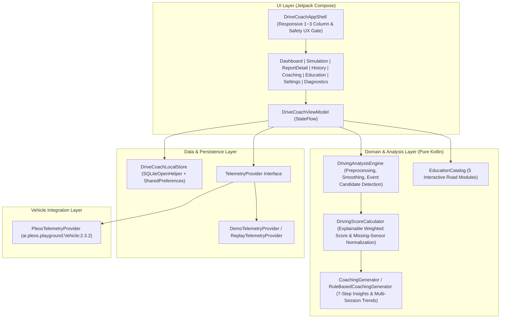
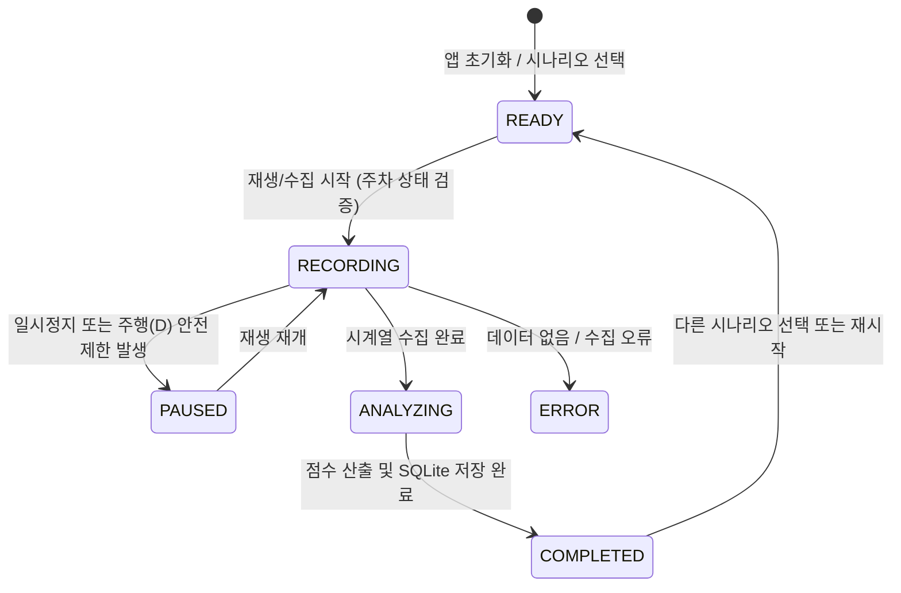

# DriveCoach 소프트웨어 아키텍처 (`ARCHITECTURE.md`)

## 1. 아키텍처 설계 원칙

DriveCoach는 차량용 인포테인먼트(AAOS / Pleos Connect) 환경의 안전성, 오프라인 지속성, 센서 가용성 변화에 대응하기 위해 **4계층 단방향 데이터 흐름(Unidirectional Data Flow, UDF)** 아키텍처를 채택했습니다.

---

## 2. 패키지 및 모듈 구조

| 패키지 경로 | 핵심 클래스 / 파일 | 역할 및 책임 |
| :--- | :--- | :--- |
| `com.drivecoach.app` | `MainActivity.kt` | Edge-to-Edge 시스템 바 설정, `DriveCoachViewModel` 바인딩, 시스템 뒤로가기(`BackHandler`) 처리 |
| `com.drivecoach.app.domain.model` | `TelemetryModels.kt`, `SessionAndAnalysisModels.kt`, `EducationModels.kt` | 데이터 출처(`DataSourceType`), 품질 플래그(`DataQualityFlag`), 텔레메트리 샘플, 이벤트 후보, 분석 결과, 코칭 카드, 교육 모델 정의 |
| `com.drivecoach.app.domain.analysis` | `DrivingAnalysisEngine.kt`, `CoachingEngine.kt`, `EducationCatalog.kt` | 단위 변환($\text{km/h} \leftrightarrow \text{m/s}$), 3점 이동평균 노이즈 완화, 종방향 가속도 추정($\Delta v/\Delta t$), 이벤트 후보 탐지, 규칙 기반 코칭 및 3·5·10회 추세 생성 |
| `com.drivecoach.app.domain.scoring` | `DrivingScoreCalculator.kt` | 가용 센서 기반 가중치 자동 정규화, 4대 안정성 지표 평가, 데이터 부족 시 `overallScore = null` 반환 |
| `com.drivecoach.app.data.telemetry` | `TelemetryProviders.kt` | `TelemetryProvider` 추상화 인터페이스 및 시나리오/저장 세션 리플레이 공급자 구현 |
| `com.drivecoach.app.data.simulation` | `DemoScenarioCatalog.kt` | 5대 표준 주행 시나리오(`smooth_driver`, `late_braking`, `abrupt_acceleration`, `steering_correction`, `mixed_driving`) 결정론적 생성 |
| `com.drivecoach.app.data.vehicle` | `PleosTelemetryProvider.kt` | 현대자동차 `ai.pleos.playground:Vehicle:2.3.2` 읽기 전용 연동(`SteeringWheel`, `Brake`, `Odometer`, `Gear`, `TurnSignal`) 및 런타임 권한·Capability 진단 |
| `com.drivecoach.app.data.local` | `DriveCoachLocalStore.kt` | Android 내장 `SQLiteOpenHelper` + `org.json` 직렬화로 주행 세션·시계열 샘플·이벤트를 영구 저장하고 `SharedPreferences`에 가중치·목표·학습 완료 상태 보관 |
| `com.drivecoach.app.ui.*` | `DriveCoachViewModel.kt`, 각 화면 Composable | 반응형 레이아웃, 캔버스 차트 렌더링, 주행 중 안전 제한 오버레이 제어 |

---

## 3. 세션 및 분석 상태 머신

주행 시뮬레이션 및 기록 수집은 `SessionRecordState` 상태 머신을 통해 명확하게 전이됩니다.

---

## 4. 주행 안전 UX 정책 (Driving Safety Gate)

1. **차량 제어 API 원천 배제**: `AndroidManifest.xml` 및 코드 전체에서 `CONTROL_CAR_*` 권한과 `set*()` 제어 메서드를 일절 사용하지 않습니다.
2. **주행 중 실시간 지시 금지**: 주행 중 "핸들을 15도 돌리세요"와 같은 위험한 실시간 조향 지시를 제공하지 않습니다.
3. **주행 상태 화면 차단 오버레이**: 실제 기어 상태(`GearPosition.DRIVE` / `REVERSE`) 또는 상단 시연 토글이 주행 상태일 때는 복잡한 차트·시뮬레이션·교육 화면을 차단하고 `DrivingSafetyRestrictionOverlay`를 표시합니다.
